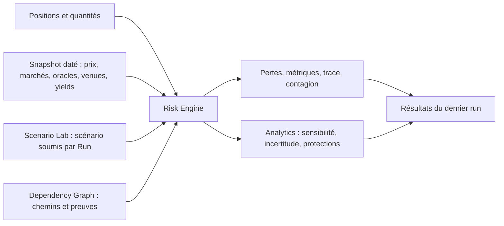
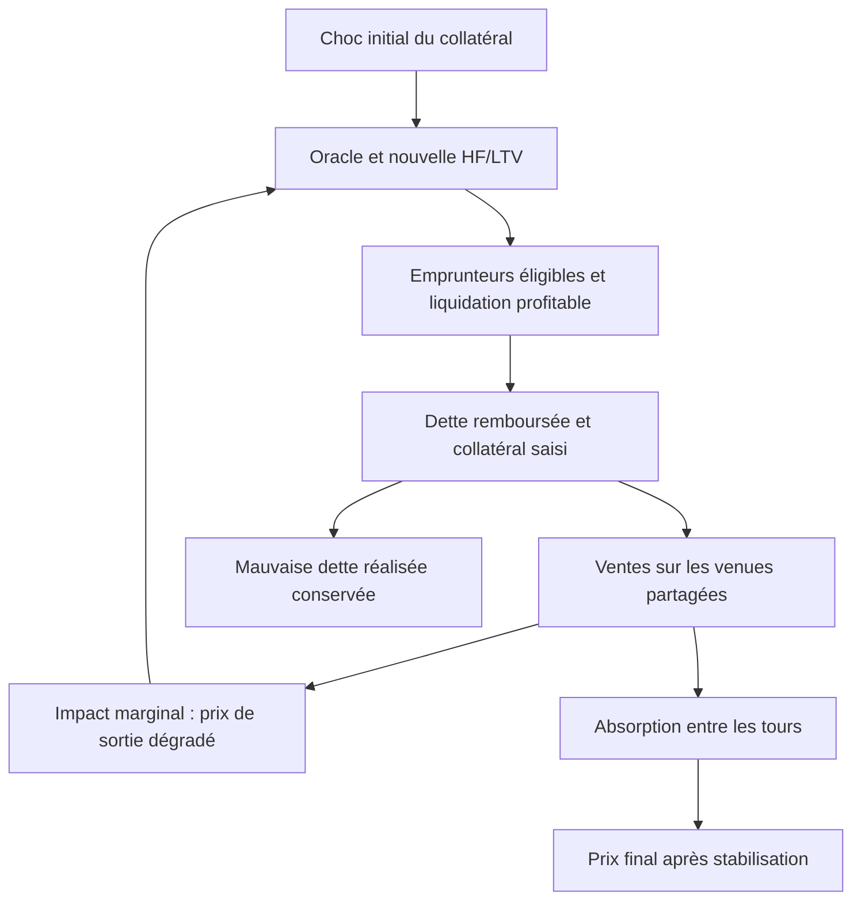

# Risk Engine : comprendre chaque chiffre et son calcul

Ce guide décrit **le code actuel**, modèle `risk-v0.1`, et la correspondance avec l'interface. Les scénarios sont conditionnels : une perte affichée signifie « perte selon ces positions, ces observations et ces hypothèses si ce scénario se produit ». Le moteur ne transforme pas automatiquement un événement macro en une prévision de marché certaine.

Navigation : [scénarios et exemples](risk_scenarios.md), [portefeuille stress](stress_portfolio.md), [marchés vérifiés](verified_markets.md), [validation historique](historical_backtest.md), [résultats historiques](backtests/results.md).

## 1. Parcours et entrées



`portfolio` fournit types de positions, quantités, actifs, dettes et venues. `market_snapshot` fournit prix USD, taux de conversion, paramètres de chaque marché, rendements, distribution d'emprunteurs, quotes/profondeurs de sortie et provenance. `scenario_request` fournit le scénario, l'horizon et **tous** ses paramètres. `dependency_graph` apporte les liens et leurs preuves.

[engine.py](../backend/risk/engine.py) vérifie les identifiants du portefeuille, du snapshot et, s'il est fourni, du graph avant de calculer. Une incompatibilité est une erreur. Le graph n'est pas un simple multiplicateur financier : les mécanismes de prix, d'oracle, de liquidation et de liquidité déterminent les pertes ; les chemins documentent et contrôlent les dépendances.

Le dashboard et le graph de dépendances présentent l'état initial. Bouger un curseur prépare un scénario ; les résultats correspondent au **dernier scénario soumis**, pas à chaque mouvement du curseur. Les propositions IA sont éditables dans Scenario Lab. Elles ne constituent pas un run : c'est la requête validée lors de Run qui déclenche les calculs. Une baisse des taux américains ou du dollar doit d'abord être traduite en hypothèses économiques prises en charge ; le moteur actuel est en USD et n'a pas de facteur EUR/USD natif.

`data_origin` décrit les positions : une allocation synthétique peut utiliser des marchés réels. « Marché vérifié » ne signifie ni portefeuille détenu par un utilisateur réel, ni donnée actuelle, ni prédiction validée. La date, le bloc et la provenance restent essentiels.

## 2. Unités et signes

| Type | Convention de calcul | Exemple |
|---|---|---|
| Montant | USD ; chaînes décimales dans les contrats | `"1150000.00"` = 1,15 million de dollars |
| Choc de prix signé | Fraction | `−0.10` = baisse de 10 % |
| Réduction de liquidité | Fraction positive retirée | `0.80` = 80 % retiré, 20 % restant |
| Rendement/taux | Fraction annualisée ; intérêt simple dans carry | `0.60` = 60 % par an |
| Déplacement de seuil/taux | Points de fraction, additifs | `−0.03` : LT 0,85 → 0,82 |
| Horizon | Nombre de jours | 30 = 30 jours pour carry, pas 30 tours de cascade |
| Perte | Positive = perte ; négative = gain | `−1000` = gain de 1 000 USD |
| `loss_pct` d'une quote | Pourcentage numérique | `"2.5"` = 2,5 % ; le modèle divise par 100 |

Calculs en float64, puis arrondi monétaire à 2 décimales et des ratios du résultat à 4 décimales. [report.py](../backend/risk/report.py) arrondit les composantes avant les sommes pour que les chiffres publiés se réconcilient au centime. Les analytics utilisent leur propre arrondi ; de petits écarts sont possibles entre séries.

## 3. Valeur initiale et prix stressés

Notations : P = prix, Q = quantité, R = parts sUSDe converties en USDe, C = valeur de collatéral, D = dette, LT = seuil Aave, LLTV = seuil Morpho, s = choc USDe, b = beta sUSDe, i = impairment du backing, r = coupe du taux de conversion.

Les formules de base sont dans [pricing.py](../backend/risk/pricing.py) :

```text
P_sUSDe,0 = R_sUSDe/USDe × P_USDe,0
valeur_holding = Q × P_actif
collatéral = Q_collatéral × P_collatéral
dette = Q_dette × P_dette
net_equity = collatéral ou actif brut − dette

P_USDe,1 = P_USDe,0 × (1+s) × (1+i)
P_sUSDe,1 = P_sUSDe,0 × (1+b×s) × (1+i) × (1+r)
```

Une baisse de 10 % puis une perte de backing de 5 % donne un facteur `0.90 × 0.95 = 0.855` : les deux chocs ne s'ajoutent pas simplement. Les prix USDC, PYUSD, RLUSD, USDT, DAI sont traités séparément lorsqu'ils sont observés ; un stablecoin de dette qui baisse peut réduire la dette en USD et produire un gain du côté emprunteur.

PT :

```text
P_PT = valeur_du_claim_sous_jacent × facteur_de_coupe / (1 + APY_implicite + déplacement_APY)^(jours_à_maturité / 365)
```

Dans la convention actuelle PT-sUSDe, le claim à maturité vaut **1 USDe**, pas une part sUSDe entière multipliée par son taux de conversion. À maturité, le discount disparaît. Une hausse de l'APY implicite baisse la valeur actuelle du PT. Ce pricing est une approximation par rendement implicite ; une quote AMM ne doit pas être confondue avec ce prix théorique.

### Oracle versus marché

Pour un collatéral touché, l'oracle voit :

```text
C_oracle,1 = C_oracle,0 × (1 + pass_through × mouvement_marché) × (1 + coupe_du_taux)
```

`pass_through = 0` peut protéger la métrique de liquidation contre un depeg de marché, sans protéger la valeur économique du collatéral. Une coupe du taux sUSDe est vue même par un oracle à USDe fixé à 1 USD. Une perte de prix et un seuil de liquidation sont donc deux objets différents.

## 4. Health factor et LTV : par position emprunteuse

[metrics.py](../backend/risk/metrics.py) :

```text
Aave : HF = C_oracle × LT / D
       liquidatable si HF < 1
       distance = 1 − 1/HF
Morpho : LTV = D / C_oracle
         liquidatable si LTV > LLTV
         distance = 1 − LTV/LLTV
```

Le health factor affiché est celui de **la position sélectionnée**, pas du portefeuille entier. Une position holding ou prêteur n'a pas de HF d'emprunteur. Pour Aave, 1,0729 → 0,7832 signifie que le ratio de couverture pondéré du seuil passe sous 1. La distance après choc vaut environ `1 − 1/0.7832 = −27.7 %`. Ce n'est ni la perte du portefeuille, ni la part déjà liquidée : c'est une marge algébrique au seuil devenue négative.

Le label `liquidatable` signifie éligible à liquidation dans le modèle. Hors scénario cascade, le moteur ne rejoue pas un historique de transactions effectives.

Pénalité simplifiée hors cascade :

```text
liquidation_penalty = close_factor × dette_après × incentive
Aave : close_factor = 50 % si HF ≥ 0,95 ; 100 % si HF < 0,95
Morpho : close_factor = 100 %
```

Ces règles sont celles implémentées. Elles doivent être revérifiées contre les paramètres/version du déploiement au bloc historique avant une validation de transactions réelles. Cette formule décrit un appel quand le prix de marché égale celui de l'oracle et que le collatéral suffit. Le code actuel répète les appels si nécessaire, plafonne la saisie au collatéral restant et refuse un appel non rentable. La pénalité publiée vaut la valeur de marché totale du collatéral saisi moins la dette remboursée. La pénalité n'est pas toute la dette remboursée : le principal remboursé et le collatéral saisi ne constituent pas deux pertes additionnelles indépendantes.

## 5. Les sept scénarios et leurs mécanismes

| Scénario | Ce qui change | Rôle de l'horizon | Référence éventuelle |
|---|---|---|---|
| `usde_depeg` | Prix USDe, beta sUSDe, backing, coupe du taux, discount PT, lecture des oracles | Pas d'accrual automatique du rendement ; lag en heures décrit une fenêtre de protection | Aucun contrefactuel dédié |
| `liquidity_crisis` | Profondeur de sortie ; choc fondamental facultatif | La profondeur stressée n'est pas une prévision quotidienne | Sorties seules versus sortie jointe |
| `combined_crisis` | Depeg puis liquidations puis sortie du fonds derrière les ventes forcées | Un enchaînement, sans rétroaction répétée vers les oracles | Même choc sans ventes forcées devant le fonds |
| `carry_squeeze` | Rendement sUSDe, intérêts de dette/collatéral/supply, maturité PT | Intérêt simple `jours/365`, sans choc de prix USDe | Même horizon aux taux du snapshot |
| `governance_change` | LT/LLTV et pass-through de marchés ciblés, puis depeg | Changement appliqué avant le choc | Même depeg sans changement de gouvernance |
| `node_shock` | Mécanisme choisi selon le nœud touché : backing, taux, dette stablecoin, perte de protocole | Ne crée pas automatiquement une trajectoire temporelle | Chemins de dépendance utilisés comme contrôle |
| `liquidation_cascade` | Choc → liquidations → ventes → prix/oracles → liquidations supplémentaires | Tours de résolution, **pas jours** | Même crise sans boucle complète |

Tous les paramètres et exemples concrets : [risk_scenarios.md](risk_scenarios.md). Les schémas de chaque scénario sont dans [contracts/schemas/v1/scenarios](../contracts/schemas/v1/scenarios/).

Carry applique :

```text
R_h = R_0 × max(1 + rendement_sUSDe × h/365, 0)
Q_dette,h = Q_dette,0 × (1 + taux_emprunt × h/365)
Q_collatéral,h = Q_collatéral,0 × (1 + rendement_supply × h/365)
```

Le collatéral sUSDe profite aussi de son taux de conversion. Les prêteurs subissent la dérive des emprunteurs si leurs dettes croissent plus vite que leur collatéral. `days_to_liquidation` cherche le franchissement sur un maximum de 3 650 jours à ces taux constants ; ce n'est pas une date prédite.

Gouvernance applique le déplacement de LT/LLTV de manière additive, borné entre 0 et 0,99 ; `target_markets` choisit les marchés. Node shock : USDe/Ethena/offchain → backing ; sUSDe → taux de conversion ; stablecoin → dette en USD ; protocole/marché/PT → perte sur positions correspondantes. Le modèle node shock ne reconstitue pas toutes les pertes offchain des contreparties.

## 6. Prêteurs : comment le collatéral des autres atteint ma supply

Un `lending_supply` détient l'actif prêté, pas directement le collatéral des emprunteurs. [lending.py](../backend/risk/lending.py) utilise des buckets d'emprunteurs : dette pondérée et LTV initiale.

Pour un bucket :

```text
dette_bucket = dette_totale_marché × debt_share
C0_bucket = dette_bucket / LTV_initial
C_oracle = C0_bucket × facteur_oracle
C_marché = C0_bucket × facteur_marché

si liquidatable : bad_debt = max(dette − max(C_oracle, 0)/(1+incentive), 0)
sinon : undercollateralized_debt = max(dette − max(C_marché, 0), 0)
part_supply = min(quantité_fonds / supply_totale, 1)
perte_prêteur = part_supply × somme(bad_debt + undercollateralized_debt)
```

Les montants en actifs de dette sont convertis en USD quand le scénario construit les pertes. Dans la cascade, les ventes et la mauvaise dette sont traitées par la boucle dédiée. La mauvaise dette du marché entier n'est pas automatiquement la perte entière de notre fonds.

`bad_debt` désigne la mauvaise dette réalisée par le mécanisme de liquidation modélisé. `undercollateralized_debt` est une décote économique latente lorsque le marché voit un déficit que l'oracle ne rend pas encore liquidatable ; elle repose sur l'hypothèse qu'un emprunteur rationnel peut abandonner la position. Ce n'est pas un événement de défaut effectivement constaté.

Le retrait dépend de la liquidité disponible :

```text
withdrawable = min(quantité_fonds, max(supply_totale − borrow_total, 0) × (1 − réduction_liquidité))
```

La supply bloquée jusqu'au remboursement est un **délai**, pas une perte automatique. Des seuils franchis peuvent donc produire un warning de dette liquidatable sans aucune perte prêteur à cette taille de choc.

## 7. Prix d'exécution et contagion par la liquidité

Dans [liquidity.py](../backend/risk/liquidity.py), Q désigne ici la **taille USD vendue**, profondeur d, et k la part de profondeur restante :

```text
coût_proxy(Q) = Q² / (k×d + Q)
haircut_moyen = Q / (k×d + Q)
valeur_exécutable_brute = valeur_brute_après − execution_haircut
```

Si des quotes existent, le modèle interpole leur fraction de perte en fonction de la taille, avec une origine à zéro et un plancher non décroissant. Au-delà de la plus grande quote, il extrapole via une profondeur équivalente : cette partie est une hypothèse, signalée. Avec une profondeur multipliée par k, il utilise `coût_k(Q) = k × coût_normal(Q/k)`. Frais/gaz des plans de sortie sont comptabilisés par les analytics dédiées ; ne pas les rajouter aveuglément à une quote all-in.

Plusieurs positions sur la même venue :

```text
shared_liquidity_penalty = somme_venues[coût(somme_tailles) − somme(coût(taille_seule))]
```

Cette composante existe au niveau portefeuille seulement. Additionner les barres de pertes individuelles peut donc donner un total inférieur à la perte portefeuille.

Dans combined, après une quantité forcée F :

```text
coût_de_sortie_du_fonds = coût(F + Q) − coût(F)
```

Une position peut ainsi subir les liquidations d'une autre, même si son propre seuil ne bouge pas. Combined effectue cet enchaînement une fois ; cascade réinjecte les prix dégradés dans les seuils jusqu'à arrêt.

## 8. Cascade : cause → effet → nouveau tour



[cascade.py](../backend/risk/cascade.py) traite les buckets les plus sous-collatéralisés d'abord, par morceaux initialement égaux à 5 % de leur dette. La profondeur/les quotes donnent l'impact marginal des ventes ; les prix et l'éligibilité sont mis à jour. L'absorption réduit la pression de ventes entre les tours ; il n'y a pas d'arbitrage explicite USDe ↔ sUSDe entre venues.

Deux comportements : `liquidators_internalize_impact = false` accepte une liquidation rentable au prix courant ; `true` réduit sa taille pour vérifier que sa propre vente n'efface pas l'incentive. Le code borne les morceaux et le nombre d'itérations. Un maximum de 50 tours ou l'épuisement des gardes numériques produit un résultat non convergé/incomplet avec warning.

| Sortie `cascade` | Sens |
|---|---|
| `initial_moves` | Chocs initiaux par actif |
| `final_moves` | Chocs à la fin de la boucle ; utilisés pour les valeurs finales |
| `trough_moves` | Pires prix rencontrés ; ne pas les confondre avec les prix finaux |
| `rounds` | Pour chaque tour : dette liquidée, collatéral vendu, mouvements de prix |
| `liquidated_debt_usd` | Principal liquidé dans les buckets modélisés, pas perte totale du fonds |
| `bad_debt_usd` | Mauvaise dette réalisée dans les buckets de marché ; le fonds prêteur en porte sa quote-part |
| `stuck_debt_usd` | Dette restante des buckets bloqués, notamment par la rentabilité des liquidateurs |
| `amplification` | Maximum, parmi les actifs avec choc initial non nul, de `mouvement_final/mouvement_initial` ; pas ratio perte fonds/perte initiale |
| `converged` | La boucle a satisfait son critère d'arrêt ; ne prouve pas la validité empirique du modèle |

Un rebond du prix final ne supprime pas la bad debt réalisée au creux. Les tours décrivent un ordre de propagation, pas un calendrier. Une absence de liquidation nouvelle significative peut arrêter la boucle, même si des dettes restent bloquées.

## 9. Dictionnaire de `risk_result` et réconciliation

Contrat complet : [risk_result.schema.json](../contracts/schemas/v1/risk_result.schema.json).

| Champ de position | Lecture exacte |
|---|---|
| `gross_value_before_usd` | Valeur brute recalculée avant choc |
| `gross_value_after_usd` | Valeur brute au prix stressé, avant déduction des composantes de perte séparées |
| `debt_after_usd` | Dette valorisée après choc/intérêts selon le scénario |
| `net_equity_before_usd` | Base nette recalculée par le moteur |
| `conditional_loss_usd` | Somme des composantes monétaires arrondies |
| `net_equity_after_usd` | Net initial − perte conditionnelle ; plafonné à zéro pour les emprunts non recourse |
| `executable_value_after_usd` | Valeur brute après − haircut de sortie, si calculé ; **ce n'est pas le cash net après remboursement de dette** |
| `risk_metric` | HF/LTV avant/après, seuil, éligibilité et distance ; null si non pertinent/non calculable |
| `loss_components` | Décomposition ci-dessous |
| `trace` | Formule, entrées avec unités/provenance, résultat et notes de chaque étape |
| `contagion` | Chemins, mécanismes et couverture de dépendances |
| `source_type` | `derived` pour une sortie de modèle |
| `calculation_status`, `warnings` | Qualité/limites et données manquantes |

`gross_after − debt_after` ne restitue pas nécessairement `net_equity_after` : la pénalité et les coûts de sortie sont comptabilisés séparément. Utiliser la réconciliation publiée pour lire le résultat.

| Composante | Mécanisme |
|---|---|
| `market_repricing` | Revalorisation liée au marché/discount PT, hors couches traitées séparément |
| `backing_impairment` | Couche de perte de backing ; dans depeg, la différence entre l'état market-only et l'état final inclut aussi la coupe sUSDe |
| `liquidation_penalty` | Incentive estimé ou pénalité calculée dans la cascade |
| `execution_haircut` | Décote pour vendre dans la venue stressée |
| `negative_carry` | Valeur perdue à cause des intérêts/rendements ; négative si gain |
| `bad_debt` | Quote-part de mauvaise dette réalisée pour une supply |
| `undercollateralized_debt` | Quote-part du déficit latent des emprunteurs invisible à l'oracle |
| `limited_liability` | Composante négative plafonnant la perte d'un emprunt à sa net equity ; `min(net initial − autres pertes, 0)` |

Champs portefeuille :

```text
net_equity_before_usd = somme(net_initial_position)
total_conditional_loss_usd = somme(perte_position) + shared_liquidity_penalty_usd
net_equity_after_usd = net_initial_portefeuille − total_conditional_loss_usd
```

`aggregation_status = insufficient_data` met le total de perte et le net final à `null` si une position ne peut pas être complètement calculée. Ce n'est pas zéro. Les analytics peuvent néanmoins présenter des contributions partielles avec warning : ne pas les traiter comme un risque complet.

Identifiants de sortie : `schema_version`, `simulation_id`, `request_id`, `portfolio_id`, `scenario_id`, `horizon_days`, `currency`. `provenance` conserve la version du modèle et les identifiants de snapshot/graph. `comparison.runs` contient les simulations de référence ; `excess_loss_usd = perte_scénario − somme(pertes_références)` selon la comparaison choisie. Lire `excess_meaning` avant d'interpréter ce différentiel.

Le statut `computed` exige que le snapshot ait des marchés et qu'ils soient tous vérifiés ; sinon `illustrative`. La vérification des paramètres ne vérifie pas automatiquement les profondeurs, beta, arbitrage ou comportement des liquidateurs.

## 10. Contagion et preuves du graph

[contagion.py](../backend/risk/contagion.py) associe les positions impactées aux chemins de dépendances et à leurs preuves. `hubs` agrège les expositions brutes et nettes dépendant d'un même nœud, sans compter plusieurs fois la même position pour ce nœud. Ces expositions ne sont ni la TVL du protocole, ni une somme de pertes à additionner entre hubs.

`unmodeled_exposures` signale une dépendance dont le mécanisme n'est pas pris en charge, pas une position dont la perte calculée est zéro. Un prêteur exposé mais sans déficit à cette taille de choc reçoit un warning explicatif. `evidence_confidence` résume la preuve des dépendances ; ce n'est pas la probabilité du scénario.

Le graph initial documente « de quoi dépend mon portefeuille ». Le graph stressé et les tours documentent « par quels mécanismes ce run l'affecte ». Les rendre identiques supprimerait cette distinction utile.

## 11. Analytics : expositions, seuils et protections

Contrat : [risk_analytics.schema.json](../contracts/schemas/v1/risk_analytics.schema.json). Calcul : [analytics](../backend/risk/analytics/).

| Bloc | Calcul et interprétation |
|---|---|
| `headline.nav_usd` | Somme des nets du portefeuille d'entrée ; peut différer légèrement de la base recalculée du résultat |
| `scenario_loss_usd`, `scenario_loss_pct_nav` | Perte conditionnelle et fraction de NAV ; pas perte attendue sans probabilités |
| `usde_exposure_usd`, `usde_effective_leverage` | Exposition équivalente au facteur et exposition/NAV |
| `factor_exposure` | Petits chocs séparés prix, backing, taux sUSDe, APY PT ; exposition équivalente = variation de valeur / taille du choc |
| `breaking_points.liquidation` | Recherche par bisection du choc qui rend une position liquidatable ; choc défavorable recherché jusqu'à 99 % |
| `breaking_points.nav_drawdown` | Choc USDe qui produit 10 %, 20 %, 50 % de drawdown, selon les paramètres ; null si absent dans le domaine |
| `derisking` | Sorties ciblées versus uniformes visant la même réduction de perte conditionnelle |
| `liquidation_protection` | Taille/cost du désendettement préventif, pénalité évitée, bénéfice net |
| `sensitivity.tornado` | Changer une hypothèse à la fois et comparer les pertes ; classement d'amplitude |
| `sensitivity.grid` | Rejouer deux paramètres sur une grille de chocs ; cellules = pertes/liquidations conditionnelles |
| `position_curves` | Valeur/perte/métrique de chaque position à différentes sévérités |
| `uncertainty` | Distribution de pertes en faisant varier des hypothèses de modèle ; voir ci-dessous |

L'exposition équivalente n'est pas un solde de tokens ni une allocation indépendante à additionner entre facteurs. Les seuils bisection supposent la monotonie du mécanisme isolé ; `immune` signifie pas de franchissement trouvé dans le domaine, pas absence de tout risque.

De-risking choisit progressivement les sorties à meilleur rapport réduction de perte/coût. Les coûts incluent impact de marché, frais, gaz et carry abandonné ; les sorties sont supposées avant crise à profondeur normale. Le désengagement pro rata d'un emprunt maintient initialement sa HF/LTV.

```text
savings_usd = coût_plan_uniforme − coût_plan_ciblé
savings_bps_nav = savings_usd / NAV × 10 000
break_even_probability = coût_plan / perte_conditionnelle_évitée
```

Ce dernier chiffre est une probabilité **seuil** pour que le coût vaille la protection dans cette simplification, pas une probabilité estimée du choc. S'il dépasse 1, il ne devient pas une chance réaliste supérieure à 100 %.

Désendettement de collatéral vendu pour rembourser la dette :

```text
Aave, HF cible : montant = max((HF_cible×D − LT×C) / (HF_cible−LT), 0)
Morpho, LTV cible : montant = max((D − LTV_cible×C) / (1−LTV_cible), 0)
```

Le code vise HF 1,05 ou LTV = 95 % de LLTV, avec ajustement au choc d'oracle. Le bénéfice net préventif est la pénalité de liquidation évitée moins le coût de protection ; la baisse de prix évitée n'est pas rajoutée mécaniquement comme un second bénéfice.

## 12. « Entre 654 871 USD et 1,15 M USD dans 90 % des runs »

Ces montants sont des **pertes conditionnelles**, portefeuille entier sur la ligne Portfolio, position individuelle sur les lignes suivantes. **1,15 M USD n'est pas la valeur finale de la position.** Pour obtenir le net final d'un tirage : `net initial − perte de ce tirage`.

[uncertainty.py](../backend/risk/analytics/uncertainty.py) effectue 256 runs reproductibles avec seed `20261010`. La sévérité du scénario reste fixée ; des hypothèses sont tirées indépendamment dans leurs plages.

| Hypothèse | Plage actuelle |
|---|---|
| Beta sUSDe/USDe dans les scénarios depeg concernés | 0,50 → 1,50 |
| Pass-through d'oracle non vérifié, sans override | 0 → 1 |
| LT/LLTV d'un marché non vérifié | base − 0,05 → base + 0,03, plafond 0,99 |
| APY implicite PT non vérifié | base ± 0,03, plancher 0 |
| Multiplicateur de profondeur avec quote/provenance observée | 0,80 → 1,25, tirage log-uniforme |
| Multiplicateur de profondeur supposée | 0,50 → 2,00, log-uniforme |
| Absorption cascade | base − 0,30 → base + 0,15, borné 0 → 1 |

Les paramètres des **marchés** vérifiés restent fixes, mais la profondeur des venues varie même si elle a été observée. Dire « toutes les entrées vérifiées restent fixes » serait trop général. Les plages ne sont pas calibrées sur une longue série historique. L'indépendance des tirages est une hypothèse.

Barre fine = p5 → p95 ; barre épaisse = p25 → p75 ; point = p50/médiane ; trait = run de base. Quantiles par interpolation linéaire à l'indice `q×(n−1)`. L'histogramme présente 15 classes de **pertes**, axe vertical = nombre de tirages. Une barre réduite à un point signifie peu/pas de variation selon les hypothèses tirées, pas certitude économique absolue.

L'intervalle p5–p95 couvre la partie centrale de la distribution artificielle de paramètres. Ce n'est ni une chance de 90 % que la crise arrive, ni un intervalle prédictif validé du futur P&L. Les percentiles portefeuille ne sont pas les sommes des percentiles de positions : ils sont calculés sur les totaux de chaque run.

`drivers` classe les corrélations de rang Spearman entre hypothèses tirées et pertes. « Higher → more loss, 1.00 » décrit une association monotone dans les tirages ; ce n'est pas une probabilité, ni la preuve d'une cause indépendante. `liquidatable_positions_share` décrit la fréquence d'un **nombre** de positions liquidatables sous ces hypothèses.

## 13. Expected loss, VaR et expected shortfall

Le panneau probabilité dans [RiskEngine.tsx](../frontend/src/RiskEngine.tsx) utilise les **poids saisis par l'utilisateur** sur les points de la courbe de sévérité. Il ne les apprend pas des news ou des 256 tirages de modèle. Sans ces poids, on reste sur des stress conditionnels.

```text
Expected loss = somme(probabilité_j × perte_j)
masse_sans_choc = 1 − somme(probabilités_saisies)
```

La masse restante est affectée au point sans choc. Pour la confiance c, le front classe les pertes de la plus forte à la plus faible et parcourt une masse `1−c`. VaR = perte au bord de cette queue ; ES = moyenne pondérée des pertes dans cette queue, avec une fraction du dernier poids si nécessaire. Les confiances proposées sont 90 %, 95 %, 99 %. Ce sont des mesures sur la distribution **choisie**, pas une VaR historique calibrée.

## 14. Lire les graphiques sans ambiguïté

| Affichage | Quantité et origine |
|---|---|
| Before/After dans Scenario Lab | Net equity USD par position, avant/après le dernier run ; pas pertes ni actif brut ; les emprunts non recourse sont plafonnés à zéro |
| Health factor / LTV | Métrique de liquidation de la position emprunteuse sélectionnée |
| Whole portfolio loss | Perte totale conditionnelle, y compris pénalité des venues partagées |
| Position loss breakdown | Composantes de perte en USD ; leur somme = perte position |
| Plage d'incertitude Portfolio | p5/p95 de perte totale des tirages |
| Plage d'incertitude position | p5/p95 de perte de cette position |
| Distribution of portfolio loss | Pertes USD en abscisse ; nombre de runs en ordonnée |
| Heatmap | Deux paramètres de stress ; couleur = sortie de chaque run, pas densité de probabilité |
| Curves | Axe = sévérité ; valeur/perte/HF-LTV selon série et unité |
| Cascade rounds | Propagation par tours ; debt liquidated et sold collateral sont des volumes, pas pertes |
| Comparison excess | Différence avec un contrefactuel dont la description est attachée au run |
| Calculation trace | Formule exacte, entrées, unités, provenance, résultat |

Exemple de lecture : avec net initial 2,54 M USD et perte 1,15 M USD, net final ≈ 1,39 M USD. Ne pas déduire une valeur finale à partir d'une valeur brute ni additionner une deuxième fois la mauvaise dette du marché entier à celle de notre supply.

## 15. Solidité actuelle et limites vérifiables

Les forces techniques sont : calculs déterministes, contrats typés/validés, séparation des mécanismes, traitement explicite des données insuffisantes, réconciliation monétaire, trace des calculs, contrôle des chemins, tests des seuils/cascades et comparaisons contrefactuelles. Ces garanties de logiciel ne sont pas une preuve que toutes les hypothèses économiques sont calibrées.

Les limites actuelles comprennent intérêt simple, pricing PT approximatif, distribution d'emprunteurs regroupée en buckets, oracle pass-through simplifié, une venue par collatéral dans la cascade, arbitrage/absorption supposés, résolution par tours sans temps de bloc, liquidateurs simplifiés, et données offchain incomplètes. Les résultats dépendent des observations **datées** et de la disponibilité des quotes à la taille envisagée.

Le [rapport historique](historical_backtest.md) donne les APIs, méthodes, chiffres réellement observés et éléments restant à valider. Il explique pourquoi une erreur USDe nulle dans un rejeu ne suffit pas à dire que « le backtest est bon ».

## 16. Surfaces pré-calculées et champs d'incertitude

[risk_surface.schema.json](../contracts/schemas/v1/risk_surface.schema.json) décrit une grille de résultats calculés et stockés pour le mode offline. `surface_id`, `portfolio_id`, `snapshot_id` identifient sa base. Chaque scénario indique `param`, `base_request_id`, puis des `points` contenant `value` (valeur du curseur), `risk_result` (sortie à ce point) et `decisions` (résultats du moteur de décision). Une surface n'est ni une nouvelle observation historique ni une probabilité ; la présence d'un fichier de surface ne signifie pas qu'un utilisateur vient de lancer un run.

Dans `uncertainty`, `draws`/`seed` identifient les tirages ; `portfolio` et `positions` contiennent `p05_usd`, `p25_usd`, `p50_usd`, `p75_usd`, `p95_usd`, `min_usd`, `max_usd`, `base_usd`. `histogram` contient bornes USD et nombres de tirages. `drivers` contient l'hypothèse, ses bornes et sa corrélation de rang. `fixed_because_verified` liste les marchés laissés fixes. `position_curves` publie `x_param`, `x_values`, `positions_usd`, `total_usd` : ces courbes sont des **pertes**, pas des valeurs finales ou des HF.

La responsabilité limitée concerne les emprunts du fonds : elle ne supprime pas le déficit des prêteurs, ni une dette résiduelle bloquée dans les sorties de cascade. Le code courant peut donc afficher une perte emprunteur plafonnée tout en affichant de la bad debt au niveau marché.
